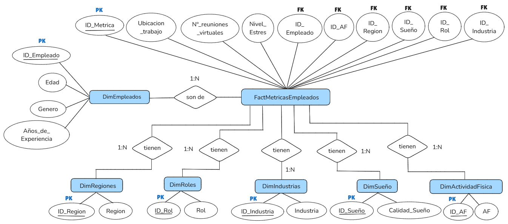

# Impacto del Trabajo Remoto en la Salud Mental

Proyecto de analisis de datos con enfoque en **SQL Server**: modelado relacional, carga de datos, consultas basicas y avanzadas, e interpretacion de resultados sobre bienestar laboral.

**Dataset:** [Remote Work and Mental Health (Kaggle)](https://www.kaggle.com/datasets/waqi786/remote-work-and-mental-health) — 5.000 empleados.

---

## Objetivo

Analizar como la modalidad de trabajo (presencial, hibrido, remoto) se relaciona con estres, salud mental, sueno, aislamiento social, productividad y satisfaccion laboral, utilizando un modelo de datos normalizado en SQL Server.

---

## Tecnologias utilizadas

| Herramienta | Uso en el proyecto |
|---|---|
| **Excel** | Descarga, limpieza y normalizacion del dataset de Kaggle |
| **SQL Server** | Creacion de base de datos, tablas, inserciones y consultas |
| **DiagramNet** | Diagrama entidad-relacion del modelo |
| **Python** | Exportacion de CSV procesados, validacion y analisis complementario |

---

## Estructura del proyecto

```text
Proyecto-TrabajoRemoto-SaludMental/
|
├── assets/
│   └── diagrama_er.png
|
├── data/
│   ├── raw/                              # Dataset original sin procesar
│   │   └── Impact_of_Remote_Work_on_Mental_Health.json
│   └── processed/                        # CSV listos para importar en SQL Server
│       ├── CSV_Empleados.csv
│       └── CSV_Metricas_Empleados.csv
|
├── sql/
│   ├── ddl/                              # Definicion de base de datos y tablas
│   │   └── 01_creacion_bd_tablas.sql
│   ├── dml/                              # Carga de datos
│   │   ├── 02_insercion_dimensiones.sql  # INSERT manual (catalogos)
│   │   └── 03_carga_bulk_empleados_metricas.sql  # BULK INSERT (CSV)
│   └── queries/                          # Consultas de analisis
│       ├── 04_consultas_basicas.sql
│       └── 05_consultas_avanzadas.sql
|
├── docs/
│   └── RESULTADOS_Y_ANALISIS.md          # Analisis final e interpretacion
|
├── scripts/
│   ├── export_csv_for_sql.py             # Genera CSV en data/processed/
│   ├── build_db_and_analyze.py           # Regenera el informe de resultados
│   └── validate_results.py               # Valida conteos vs dataset original
|
├── README.md
└── .gitignore
```

---

## Flujo de trabajo del proyecto

### Paso 1 — Preparacion de datos (`data/`)

1. Descargar el dataset original desde Kaggle → guardar en `data/raw/`.
2. Limpiar y normalizar en Excel (o con `scripts/export_csv_for_sql.py`).
3. Exportar dos CSV con separador `;` en `data/processed/`:
   - `CSV_Empleados.csv` → tabla `DimEmpleados`
   - `CSV_Metricas_Empleados.csv` → tabla `FactMetricasEmpleados`

### Paso 2 — DDL (`sql/ddl/`)

**Archivo:** `sql/ddl/01_creacion_bd_tablas.sql`

- Creacion de la base `TrabajoRemoto_SaludMental`.
- Creacion de 7 tablas con claves primarias y foraneas.
- Modelo tipo **estrella**.

> **Convencion:** identificadores SQL solo con ASCII (`DimSueno`, `Anos_de_Experiencia`, `ID_Sueno`).

### Paso 3 — Carga de catalogos (`sql/dml/` — INSERT manual)

**Archivo:** `sql/dml/02_insercion_dimensiones.sql`

Tablas cargadas **manualmente** (pocos registros fijos):

| Tabla | Registros |
|---|---|
| `DimActividadFisica` | 3 |
| `DimSueno` | 3 |
| `DimIndustrias` | 7 |
| `DimRoles` | 7 |
| `DimRegiones` | 6 |

### Paso 4 — Carga masiva (`sql/dml/` — BULK INSERT)

**Archivo:** `sql/dml/03_carga_bulk_empleados_metricas.sql`

Tablas cargadas **desde CSV** en `data/processed/`:

| Tabla | Archivo CSV | Registros |
|---|---|---|
| `FactMetricasEmpleados` | `CSV_Metricas_Empleados.csv` | 5.000 |
| `DimEmpleados` | `CSV_Empleados.csv` | 5.000 |

### Paso 5 — Consultas (`sql/queries/`)

| Archivo | Contenido |
|---|---|
| `04_consultas_basicas.sql` | 35 consultas (SELECT, WHERE, agregaciones, HAVING, funciones de texto) |
| `05_consultas_avanzadas.sql` | 13 consultas (subconsultas, JOIN, segmentacion por modalidad) |

### Paso 6 — Analisis final (`docs/`)

**Archivo:** `docs/RESULTADOS_Y_ANALISIS.md`

Resultados, interpretacion, conclusiones y recomendaciones.

---

## Modelo de datos



| Tabla | Tipo | Descripcion |
|---|---|---|
| `FactMetricasEmpleados` | Hechos | Metricas de trabajo, estres, salud mental y productividad |
| `DimEmpleados` | Dimension | Edad, genero, experiencia, satisfaccion |
| `DimRegiones` | Dimension | Region geografica |
| `DimRoles` | Dimension | Rol laboral |
| `DimIndustrias` | Dimension | Sector industrial |
| `DimSueno` | Dimension | Calidad del sueno |
| `DimActividadFisica` | Dimension | Frecuencia de actividad fisica |

---

## Como ejecutar

### En SQL Server

Ejecutar **en este orden**:

```
1. sql/ddl/01_creacion_bd_tablas.sql
2. sql/dml/02_insercion_dimensiones.sql
3. sql/dml/03_carga_bulk_empleados_metricas.sql
4. sql/queries/04_consultas_basicas.sql
5. sql/queries/05_consultas_avanzadas.sql
```

Antes del paso 3, ajustar la ruta absoluta en `03_carga_bulk_empleados_metricas.sql` si tu carpeta del proyecto difiere.

### Scripts de apoyo (Python)

```bash
python scripts/export_csv_for_sql.py
python scripts/build_db_and_analyze.py
python scripts/validate_results.py
```

---

## Resultados y conclusiones

Informe completo con tablas e interpretacion detallada: **[docs/RESULTADOS_Y_ANALISIS.md](docs/RESULTADOS_Y_ANALISIS.md)**

### Cifras clave

| Indicador | Resultado |
|---|---|
| Registros analizados | 5.000 |
| Edad promedio | 41,0 anos |
| Estres alto | 1.686 (33,7 %) |
| Modalidad remota | 1.714 (34,3 %) |
| Acceso a recursos + aislamiento elevado | 1.465 |
| Remotos con mas horas que promedio presencial | 843 |

*Conteos validados contra el dataset original (`data/raw/`).*

### Conclusiones

- **No hay un modalidad claramente peor:** remoto, hibrido y presencial muestran distribuciones similares en estres y salud mental; el dataset esta muy balanceado.
- **El riesgo es transversal:** estres alto, condiciones de salud mental y sueño pobre aparecen en proporciones altas en toda la muestra, no solo en remoto.
- **Recursos no bastan solos:** 1.465 empleados tienen acceso a apoyo de salud mental pero aislamiento social por encima del promedio de quienes no tienen acceso.
- **La carga horaria importa:** 843 remotos superan el promedio de horas del modo presencial, lo que puede afectar equilibrio vida-trabajo.

### Recomendaciones

1. Monitorear horas trabajadas en modalidad remota e hibrida.
2. Complementar recursos de salud mental con acciones contra el aislamiento social.
3. Medir satisfaccion y bienestar de forma periodica, segmentando por region y rol.

---

## Que mostrar en portfolio

| Carpeta | Que demuestra |
|---|---|
| `data/` | Preparacion y normalizacion de datos |
| `sql/ddl/` + `sql/dml/` | Modelado y carga en SQL Server |
| `sql/queries/` | Dominio tecnico de SQL |
| `docs/` | Capacidad de analisis e interpretacion |

No hace falta interpretar una por una las 35 consultas basicas; el valor esta en el informe final y las consultas avanzadas.

---

## Autora

**Ariana Maldonado** — Analista de Datos  
[LinkedIn](https://www.linkedin.com/in/ariana-maldonado/)
